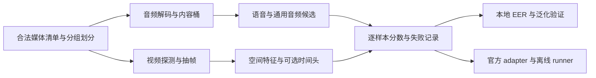

# AIGC 音视频伪造识别赛整体实施方案

状态：**已确认，执行中（2026-10-07）**
编制日期：2026-10-07
适用范围：音频检测、视频检测两个项目；用户已明确授权“开始执行，完成整个比赛项目”，按 P0 及后续阶段实施。

## 1. 目标、成功标准与边界

### 1.1 目标结果

在官方安全屋内交付两条可复现、可离线批量运行的检测流水线：

- 音频流水线对每个媒体输出连续伪造分数；
- 视频流水线对每个媒体输出连续伪造分数；
- 内部统一为 `fake=1`、分数越高越倾向伪造；
- 通过独立 adapter 显式转换为官方输入、标签、分数方向和输出格式；
- 用 EER 作为模型选择主指标，同时记录失败率、吞吐、峰值资源和分组表现；
- 所有数据、权重、配置、代码版本和结果均可追溯，并能在断网环境复跑。

官方公开材料说明音频和视频各约 10,000 条、真假约各半，主指标均为 EER，且越低越好；证据见
[`docs/competition/requirements.md`](../../docs/competition/requirements.md#L13-L22) 和
[`docs/competition/source/赛题说明.md`](../../docs/competition/source/%E8%B5%9B%E9%A2%98%E8%AF%B4%E6%98%8E.md#L5-L20)。
安全屋采用上传代码、平台挂载数据、离线执行的 2-1-2-1 六日流程，每个项目最多提交三份结果；证据见
[`docs/competition/source/比赛规则.md`](../../docs/competition/source/%E6%AF%94%E8%B5%9B%E8%A7%84%E5%88%99.md#L1-L3)。

### 1.2 最终验收标准

1. 音频、视频各有一个冻结的最低可交付模型和最多两个有消融证据的候选模型。
2. 任一正式候选均生成逐样本连续分数、失败记录、配置、权重哈希、数据清单哈希和运行报告。
3. 本地 EER 实现通过边界测试，并与 ASVspoof 参考实现及后续官方实现完成差异核对。
4. 训练、开发、最终留出之间不存在已知原媒体、派生样本、人物/说话人、近重复或来源组泄漏。
5. 音频报告区分语音、音乐、环境声、音效及混合内容；视频报告区分人脸操纵、通用生成视频和其他内容。
6. 平台时限未知时先给万条外推；公布后原始外推不超过限额 80%，即含余量的安全外推不超过限额。
7. 离线包在干净环境完成安装、推理、恢复、输出校验和断网测试；`ruff`、`mypy`、测试及构建通过，验证缺口明确。
8. 不承诺固定 EER 或名次；只有真实冻结留出集结果才能写入项目结论。

### 1.3 非目标

- 不建设 UI、身份检索、底图溯源、取证展示或 Windows 桌面安装器。
- 不默认复用旧项目阈值、模型分带和历史 AUC；也不把视频限制为人脸伪造、音频限制为语音。
- 不在公开测试、平台测试或最终冻结留出上反复调参。
- 不在模型选择前引入大模型训练栈或完整 CUDA 栈；不假定音视频融合或两个项目共用提交格式。

## 2. 已完成准备与当前约束

### 2.1 准备与工程实施；不能误报为鉴伪效果

- 已核对公开赛题、规则和赛程，并把未知执行契约登记在
  [`docs/competition/requirements.md`](../../docs/competition/requirements.md#L24-L42)。
- 已完成论文和上游项目初筛；候选方法、许可证边界与适用限制见
  [`docs/research/literature.md`](../../docs/research/literature.md#L5-L56)。
- AASIST、ASVspoof 2021、Community Forensics 参考仓库已固定到具体提交，仅作为源码参考；登记见
  [`docs/research/reference-projects.json`](../../docs/research/reference-projects.json#L1-L29)。
- FFmpeg、uv、11 项 Git 跟踪的项目 skills 和音视频/研究依赖及互斥 CPU/CUDA 后端已准备。版本、来源和环境证据以 [`tooling.md`](../research/tooling.md) 为准；真实数据和权重的获取/验收进展见 [`status.md`](../status.md)。
- 历史材料已移至 `archive/legacy-20261005/`；1,526 个文件、138,273,682 字节由 SHA-256 清单保护，见
  [`archive/README.md`](../../archive/README.md#L1-L17) 和
  [`archive/integrity-manifest.json`](../../archive/integrity-manifest.json)。
- 新包已有数据治理、指标、候选模型、训练、可恢复推理和打包代码，使用方法见 [`development.md`](../development.md)。合成行为测试和 GPU profile 不证明真实鉴伪效果。
- 归档完整性、主动工程和旧评测器测试均有本地验证；数量和阶段门以 [`status.md`](../status.md) 及工作记录为准，不能代替真实数据验收。

### 2.2 资源约束

- 本地首选资源：RTX 4060 Laptop、8GB 显存，已在沙箱外读取驱动 616.92；普通 Codex App 沙箱中 NVML 访问受阻。用户已持续授权自由使用本地 GPU；方案确认后，适合 GPU 的本地工作默认自动使用 CUDA。依赖环境探针与实际模型的显存/吞吐验收分开记录。
- 当前主机约 19GiB 内存、716GiB 可用磁盘；数据和缓存预算必须在 P1 重新按真实语料核算。
- 云算力预算待定。云端是条件分支，不能成为 P1/P2 最低可交付路径的前置条件。
- 项目基线是 Python 3.12、uv；基础运行依赖仍为空，开发/研究/音视频组和 CPU/CUDA 可选后端已锁定，见
  [`pyproject.toml`](../../pyproject.toml#L1-L31)。
- 旧 fairseq/XLS-R 配方与 Python 3.12 兼容性未知；不得污染主环境。

### 2.3 初始本地资源策略（项目约定，非实测性能保证）

- 先用不超过 30 分钟的少量样本 profile 试 batch/切片/帧数；任一模型正式训练前做不超过 2 GPU 小时 pilot，先证明损失、显存和吞吐正常。pilot 通过后自动进入已排定的正式实验，不再等待本地 GPU 使用确认。
- 单次进程峰值显存目标 ≤7GiB，留 1GiB 给驱动/显示等开销；同时记录 PyTorch allocated/reserved 与可取得的设备级用量。OOM 先减 batch、帧/切片并冻结主干，不直接升级云端。
- 进程内存上限先取 `min(8GiB, 启动时 MemAvailable - 2GiB)`；系统至少保留 2GiB。不能按主机总 19GiB 假定全部空闲，低于可执行需求时减少 workers 或暂停该任务。
- 首批下载 ≤30GiB，派生缓存 ≤20GiB，整个新项目数据/权重/输出/缓存新增占用 ≤100GiB。P1 以清单估算并设硬检查；达到上限停止新增，先缩小代表集或清理可重建缓存，原始数据不自动删除。
- 本地 GPU 不设固定卡时上限。实验按阶段矩阵和优先级排队，充分使用可用算力；每轮以开发集收益、跨域稳定性、吞吐、温度和故障记录决定继续、缩减或停止，避免无证据重复。付费云支出仍须另行确认。
- 推理初始探针从 batch=1 开始；A0 用配方输入，视频先比较合法 224/384 输入和 4/8 帧候选，SSL 从短切片和冻结主干开始。这些仅是搜索起点，不承诺对应模型一定能在 8GB 内运行。

### 2.4 时间约束

报名公开截止日为 2026-10-18，比赛只公布为 10 月中下旬至 11 月上旬，未公布音频、视频的确切六日窗口；见
[`docs/competition/source/赛程安排.md`](../../docs/competition/source/%E8%B5%9B%E7%A8%8B%E5%AE%89%E6%8E%92.md#L1-L15)。
因此使用相对日计划，收到正式通知后再映射到日历，不能编造开赛日期。

## 3. 总体架构与文件布局

当前按最小需求实现为以下布局；可选优化按阶段门增量扩展，不预先生成空目录：

```text
configs/
  *.example.json        # 数据、模型、推理与打包模板
src/deepfake_detection_archive/
  cli.py                # 数据治理、训练、评测、推理和打包入口
  contracts.py          # 分数与失败记录契约
  config.py             # 严格配置加载、版本与哈希
  data/                 # 清单、许可审计、连通组与近重复候选
  evaluation/           # EER、报告和配对组 bootstrap
  media/                # 有资源限制的确定性音视频解码
  models/               # AASIST-L、log-mel、冻结编码器与媒体级头
  features.py           # 共享本地编码器及媒体特征提取
  experiments.py        # train/dev 审计、缓存与训练编排
  training.py           # AMP、梯度累积、早停与 checkpoint
  scoring.py            # 常驻本地资源评分
  submission/           # 格式适配、可恢复批处理和离线包
  tracking.py           # 运行元数据、哈希与原子记录
tests/                  # 单元、集成及行为回归
tools/                  # 环境/模型探针和数据导入工具
docs/worklog/           # 实施记录；真实实验另存实验卡
data/ models/ outputs/  # 本地生成且 Git 忽略；各自含机器生成 manifest
```

架构原则：媒体解码、模型分数、媒体聚合、官方 adapter 分层；同一模型可在本地和平台复用；所有异常进入 `Failure`，不得静默跳样本。



## 4. 数据、来源与划分门禁

### 4.1 清单契约

每条样本至少记录：

`sample_id`、相对路径、SHA-256、模态、真实/伪造标签、来源数据集、原始条目 ID、派生父 ID、人物/说话人 ID、生成器家族与版本、内容类型、容器/编码、时长/帧率/采样率、授权记录 ID、划分、可用状态和失败原因。

未知字段显式写为 `unknown`，不能用文件名猜测并当作事实。原媒体、切片、转码、增强、抽帧之间以 `derivation_group_id` 连接。

### 4.2 采用前门禁

1. 逐数据集登记来源页面、版本、许可证、下载日期、哈希和允许用途；许可未解决的数据不得进入训练包。
2. 全量做字节哈希；音频做声纹/音频指纹与时长辅助近重复检查，视频做关键帧感知哈希与特征近邻检查。
3. 用派生关系、人物/说话人、原视频/原音频、来源条目和近重复边构造连通组；整个组只能属于一个 split。
4. 先锁最终留出，再生成 train/dev；最终留出清单只允许评测负责人读取，模型开发不得据此选超参。
5. 至少建立来源留出和生成器家族留出；若元数据不足，报告该局限，不声称“未知生成器泛化”。
6. 分别审计音频内容类型和视频人脸/内容类型；非语音进入单独桶，视频默认全帧/局部块，人脸分支只能经验证后加入。
7. 真实和伪造样本的编码、时长、分辨率和来源分布必须审计，避免模型只学到容器或采集捷径。

### 4.3 数据门禁验收

- 所有可训练样本通过 schema、路径、哈希、解码和标签校验；审计失败条目保留在总清单及覆盖率分母，修复/排除原因明确，未通过的条目不进入训练。
- split 之间不存在相同 SHA-256、`derivation_group_id`、已知身份组或已确认近重复连通组。
- 输出总体及分组计数，并明确 `unknown` 比例。
- 固定清单和 split 哈希后才能开始正式基线训练；改变 split 会新开实验系列，旧结果不得横向比较。

候选数据的采用条件和许可风险已登记在
[`docs/research/literature.md`](../../docs/research/literature.md#L33-L44)。

## 5. EER、置信区间与模型选择契约

### 5.1 项目规范 `eer_interpolated_v1`

- 标签：`y=1` 为 fake，`y=0` 为 real；预测 fake 当且仅当 `score >= threshold`。
- `FAR = count(y=1 and score < threshold) / count(y=1)`，即伪造被错误接收为真实。
- `FRR = count(y=0 and score >= threshold) / count(y=0)`，即真实被错误拒绝为伪造。
- 非有限分数直接报错并列出样本；任一类别缺失时指标未定义并报错。
- 相同分数构成不可拆分的 tie group；按唯一分数整体移动阈值，加入两个端点，结果与输入行顺序无关；全部同分时插值得到 EER=0.5。
- 若某点 `FAR == FRR`，该值为 EER；否则在 `FAR-FRR` 变号的相邻 DET 点间做线性插值，并返回 EER、插值阈值区间和两侧离散点。
- 报告 0–1 小数，展示时可转百分比；原始 JSON 永远保留 0–1。

官方只公开“FAR 与 FRR 相等处”的定义，没有公布离散阈值、并列分数和插值实现；见
[`docs/competition/requirements.md`](../../docs/competition/requirements.md#L24-L28)。因此不得声称本地 EER 与官方完全一致。

### 5.2 交叉核对

- 在隔离测试进程只读调用固定提交的 ASVspoof 2021 参考：适配其“高分为真实”方向；它对逐行稳定排序后取 `|FAR-FRR|` 最小离散点，并不按 tie group 插值，生产运行时不得导入该仓库。
- 对有精确离散交点的无 ties 样例（如完美分离、完全反向）断言与参考相等；随机或不平衡样例分别验证各自协议预期，并报告差异。固定反例：高分为伪造，`real=[0,2]`、`fake=[1]` 时参考最近离散 EER=0.75、项目插值 EER=0.5；不得要求两者相同。全部同分数断言项目 EER=0.5；一般 ties 测顺序不变性与手算预期，例如 `real=[0,0]`、`fake=[1,1]` 的 EER=0。另测重复、缺类和 NaN/Inf。
- 官方评测代码一旦提供，新增只读 `eer_official` adapter；在固定合成向量和一次冻结验证分数上三方核对。
- 若口径差异导致候选排序变化，记录敏感性并停止最终定稿；官方实现尚不可得时可继续独立研究，不以参考实现冒充官方。官方规范提供后以其重新评估正式候选。

ASVspoof 参考实现是研究对照，不是本赛官方程序；其用途边界见
[`docs/research/literature.md`](../../docs/research/literature.md#L9-L12)。

### 5.3 不确定性和晋级规则

- `ΔEER = candidate - baseline`，按来源与组内标签组合预先分层，整组有放回抽样；原子是人物/说话人/原媒体的近重复连通组，不能拆切片或帧。分层过稀时 P1 在看模型分数前登记合并规则。
- 基线和候选使用相同组索引做配对 bootstrap；固定种子，目标 2,000 个有效重复，报告 95% percentile CI、总尝试数及缺类/指标未定义的重复数。无效重复不参与分位数；最多尝试 20,000 次，仍不足 2,000 或无效比例超过 5% 时判定证据不足，不给出正式晋级结论。
- 开发集至少有 20 个独立组且两类各由至少 10 个组覆盖，才使用该 CI 作晋级门；不足时仅列探索结果，保持原稳定基线。P1 如需调整最低样本数，须在读取候选分数之前记录。
- 正式晋级：预先指定开发集的配对 `ΔEER` CI 上界 <0、至少两个训练种子改善方向一致；预注册且每类至少 50 样本、至少 10 组的来源桶，EER 绝对退化不得超过 0.02。稀疏桶报告计数并标为证据不足，不以缺失数字冒充通过。
- 单类桶 EER 未定义，改报预先冻结开发阈值下的真实误拒/伪造误收率；对应误差率的绝对退化同样不得超过 0.02。失败率必须为 0，或已有独立冻结、真值无关且经官方允许的完整回退方案；吞吐符合第 7 节。
- 最多三份候选及顺序只在开发阶段确定。最终留出在候选和超参冻结后作为一次审计，不重排候选、不选择超参、不回流训练；若验收失败，只使用预先冻结且同次审计通过的备用基线，或报告未就绪。所有门限均为项目约定，非官方规则。

## 6. 模型路线与消融优先级

### 6.1 音频 P2 最低成本双基线

**A0：AASIST-L。** 在内容审计确认语音覆盖后，迁移最小模型结构和明确许可的必要代码；A0 使用与其配方一致的确定性裁剪/填充、16kHz 单声道和媒体级分数聚合；原始采样率文件保留，其他音频候选单独验证重采样是否损伤伪迹。AASIST-L 约 85K 参数，适合作为 8GB 首个可训练候选，但其 ASVspoof 成绩不能外推到本赛；依据见
[`docs/research/literature.md`](../../docs/research/literature.md#L7-L10)。

**A1：冻结 SSL 表征 + 轻量分类头。** 首选能在主 Python 3.12 环境合法、离线加载且 8GB 推理的编码器；先缓存冻结特征，只训练 pooling/MLP 或小型序列头。再尝试只解冻最后少量层，前提是显存和 dev 证据允许。

音频覆盖门：任何已观察到的音乐、环境声、音效或混合类型，都建立独立评测桶与可验证的覆盖方案，不设“占比显著”门槛。必要时补充经授权的通用音频冻结表征或 log-mel 轻量分类器候选，并获取对应合法数据；语音模型不能凭输入可解码而视为有效。类型未知时覆盖状态为未验证；缺数据或有效候选时，全音频验收未通过，即使语音子集指标良好。

音频消融顺序：

1. 媒体切片长度、重叠与 mean/median/log-sum-exp 聚合；
2. 对称的重采样、编码、噪声、带宽和增益增强；
3. 生成器/语言/内容类型均衡采样；
4. A0 与 A1 分数校准或简单融合；
5. 非语音覆盖属于最低交付要求，按内容审计结果与 A0/A1 并行补齐；在已有覆盖后才比较额外的通用音频优化。

旧 fairseq/XLS-R 只能放在隔离环境或容器中做兼容性探针。若 Python 3.12、许可证、离线权重或打包不满足，改用现代兼容实现；不得降低主项目 Python 版本来迁就未经证明的候选。

### 6.2 视频 P2 最低成本基线

**V0：冻结视觉特征 + 帧级轻量头 + 媒体聚合。** 确定性均匀抽帧，保比例 resize，比较中心/多裁块；使用许可清楚、可离线加载的预训练视觉编码器，缓存帧特征并训练线性或小型 MLP 头。默认不裁人脸。

视频消融顺序：

1. 帧数、时间覆盖与 mean/median/top-k trimmed 聚合；
2. JPEG/H.264、模糊、缩放和重编码的真假对称增强；
3. 原比例、多尺度和局部裁块；
4. 多生成器均衡与来源匹配；
5. 轻量特征差分、1D temporal head 或光流作为 P4；
6. 只有独立证据支持时才加入人脸补充分支或分数融合。

冻结视觉特征和未知生成器验证的依据见
[`docs/research/literature.md`](../../docs/research/literature.md#L23-L31)；旧项目只迁移常驻模型、确定性抽帧、失败记账和跨域验证思想，取舍见同文档
[`第 46–56 行`](../../docs/research/literature.md#L46-L56)。

### 6.3 P3 稳健泛化

- 固定训练预算，比较生成器覆盖而非只增加同一生成器样本。
- 分别报告域内、来源留出、生成器留出、压缩/缩放扰动和真实网络传播桶。
- 检查分数与编码、分辨率、时长、语言、人物、人脸出现之间的相关性，识别捷径。
- 校准只使用开发集；EER 排名不依赖固定阈值，但平台若要求标签，阈值必须连同适用域单独冻结。
- 融合必须用 out-of-fold 分数拟合，并与最佳单模态分支做配对比较。

### 6.4 P4 可选时间模型与云算力

只有 P2/P3 已稳定、离线包路径明确且剩余时间充足才进入 P4。

云分支触发条件必须同时满足：

1. 已有本地 profile 证明目标实验因显存或预计训练时长无法在 RTX 4060 8GB 完成；
2. 该实验能检验一个预注册假设，且无法由冻结特征/梯度累积/混合精度替代；
3. 用户已确认云预算、供应商、GPU 类型、最大时数和数据上传合规性；
4. 有本地最低可交付基线，云端失败不会阻塞提交。

云端优先做少量层解冻、轻量时间头或必要的多种子复验；不从零训练大主干。若 P4 未通过晋级规则，立即停止并回到 P3/P5。

## 7. 性能、容量与失败处理

### 7.1 万条样本吞吐估算

对音频、视频和每个候选分别在不少于 500 条、覆盖时长/分辨率/编码分位数的代表集上测量：

```text
T10k_raw = T_startup + (10000 / n_bench) * (T_bench - T_startup) + T_write
T10k_safe = 1.25 * T10k_raw
```

`1.25` 包含 20% 总预算余量（因为 `raw / 0.8 = 1.25`），覆盖平台抖动、挂载 I/O 和日志开销。记录平均、p50、p95 单样本耗时、解码/推理/写出分解、峰值显存、内存和临时磁盘。

平台限额公布后，门禁为 `T10k_safe <= T_platform`，等价于 `T10k_raw <= 0.8*T_platform`；若官方限额已含预留则更新公式并留记录。未公布时只报告外推值。

### 7.2 失败契约

- 解码失败、无有效音频/帧、音轨缺失、媒体损坏、超时、OOM、模型异常均输出独立错误码和原样本 ID。
- 覆盖率和失败率使用全部样本分母。只要有样本无法产出有限分数，且没有预先冻结、与真值无关且合法的回退评分策略，就输出 `fullset_eer=null` 及原因；成功子集 EER 仅标为诊断。不得按真值填充“必错分数”或把固定二分类分母规则当作连续分数 EER 规则。
- 正式输出如何给失败样本赋分必须等官方规范；adapter 中集中配置并用回归测试锁定。
- runner 使用原子临时文件、周期 checkpoint 和断点续跑；重跑不得产生重复或改变已完成样本顺序。

## 8. 依赖、环境、Git 与离线交付

1. P0 先验证物理机 `nvidia-smi`、驱动、PyTorch CUDA probe 和 FFmpeg 编解码支持；当前 App 的 NVML 失败作为环境限制记录。
2. 在选定 A0/A1/V0 的具体实现和权重后，才添加 PyTorch、音频、视频及模型依赖；每次新增说明用途、许可证、体积和离线来源。
3. 主环境保持 Python 3.12 和 `uv.lock`；模型权重以 SHA-256 和来源 manifest 管理，不提交 Git。
4. 旧 fairseq 或其他冲突栈使用独立锁文件/容器；不得把其传递依赖混入主锁。
5. 以契约、数据、音频、视频、稳健性、打包为小提交；每次晋级记录 commit、dirty 状态、配置/数据/权重哈希、种子和命令，冻结时建只读清单或 tag。
6. 不自动推送、上传平台或下载大数据；离线包须含依赖 wheel/镜像策略、权重、配置、许可证、入口、样例和校验脚本，并断网验证。

## 9. 里程碑、产物与验收

| 阶段 | 工作与产物 | 验收门 |
| --- | --- | --- |
| P0 本地契约/环境与官方差异表 | 重新核对[赛事总页](https://ai.xm.gov.cn/competition/competition-detail.html?id=2026c40dbb2347fba8b3c9a6294efa5b)、[赛题详情](https://ai.xm.gov.cn/competition/project-detail.html?id=2026c40item0004&competeId=2026c40dbb2347fba8b3c9a6294efa5b)和登录规范；产出 I/O 映射、未知项表、GPU/FFmpeg/Python probe 和预算 | 样例输入可枚举、输出可校验；未知项有 owner、截止点和本地约定；平台未开放时本地契约可验证，不要求虚构官方样例 |
| P1 数据/指标 | 实现 manifest、审计、组级 split、项目 EER、参考对照和 bootstrap；产出数据报告、split 哈希及边界测试 | 数据门禁、EER/bootstrap 实现及合成边界测试通过；真实候选晋级属于 P3，不是训练前置条件 |
| P2 双基线 | 实现 A0、A1、V0；产出分数、checkpoint、实验卡、profile 和失败清单 | 可重复运行；各模态首个覆盖达标基线满足 8GB、离线和万条外推门，建立真实分数而不要求优于不存在的前身 |
| P3 泛化 | 执行预注册增强、聚合、多生成器和来源/生成器留出消融；产出 `ΔEER`、CI、最差桶和决策 | 保留最低基线，只晋级满足第 5.3 节的变化 |
| P4 可选时间/云 | 仅按第 6.4 节限定假设、预算和停止时间 | 相对 P3 通过冻结协议与资源门，否则移出正式候选 |
| P5 打包/适配 | 完成 adapter、断点续跑、三份候选映射、断网安装和万条 rehearsal；产出包、SBOM、清单、手册和时长报告 | 干净环境端到端成功、网络访问为零、重复运行在容差内一致 |
| P6 冻结/提交 | 最终留出只审计开发阶段已冻结的每项目最多三份候选及预定备用，不参与选择；冻结 commit/tag、配置、权重、输出、哈希和登记表 | 结果唯一映射代码参数，失败数和总数与挂载清单一致；上传前再核规则 |

平台接口暂缺不阻塞独立本地工作：P0 将“本地可配置契约”与“官方待确认差异”分开，在方案获确认且合法数据就绪后，可继续 P1、本地 P2 及资源探针。P5 官方 adapter 的定稿和 P6 正式提交必须等待实际规范；任何默认值均标为本地假设。

## 10. 两种时间路径

### 10.1 标准 14 日路径

| 相对日 | 工作 | 完成门 |
| --- | --- | --- |
| D1 | P0 | 本地契约、官方差异表、环境 probe、资源预算 |
| D2–D3 | P1 | 清单、split、EER 和 bootstrap 通过 |
| D4–D5 | A0/A1 | 音频双基线、profile、失败报告 |
| D6–D7 | V0 | 视频基线、profile、失败报告 |
| D8–D10 | P3 | 高优先级增强、聚合、跨域消融 |
| D11 | 候选门审 | 音频/视频各冻结最低可交付候选 |
| D12 | P4 或 P3 补强 | 只做触发条件满足的高价值实验 |
| D13 | P5 | 离线包、adapter、万条 rehearsal |
| D14 | P6 预冻结 | 最终候选与应急回退齐备 |

### 10.2 最小可行 7 日路径

| 相对日 | 工作 | 强制裁剪 |
| --- | --- | --- |
| D1 | P0 + P1 骨架 | 本地契约与官方差异表、清单、split、EER 核心 |
| D2–D3 | 内容覆盖达标的音频基线 + V0 | 有非语音时同步补齐；未覆盖不能宣称完整音频交付 |
| D4 | A1 或最关键视频消融 | 按当前最差赛道选择一个 |
| D5 | 来源/生成器留出与吞吐 | 不进入 P4 |
| D6 | P5 | 离线包、adapter、恢复能力 |
| D7 | P6 预冻结 | 各项目至少一个覆盖达标的稳定候选；缺覆盖时如实报告未就绪 |

实际比赛六日窗口按官方 2-1-2-1 执行：前两天只做平台 I/O、环境和吞吐调试；冻结日停止代码变化；随后两天运行已冻结候选并提交；最后一天核对结果。算法训练和大部分消融必须在进入该窗口前完成。

## 11. 风险、缓解与停止规则

| 风险 | 缓解与停止规则 |
| --- | --- |
| 官方 I/O、时限或环境晚发布 | adapter 隔离；P0/P5 重新核对；若关键契约缺失，冻结保守单候选而非猜测 |
| 数据/权重许可不适用 | 许可门禁；未解决即删除候选，不带入训练或提交包 |
| 语音方法覆盖不了通用音频 | 发现任一非语音类型即补独立评测和覆盖；缺数据或有效候选则全音频验收不通过 |
| 人脸数据与生成视频任务错位 | 全帧/局部块为默认；人脸仅作有证据的补充分支 |
| 来源、人物或派生泄漏 | 连通组划分、近重复检查；发现泄漏后废弃整个实验系列并重划 |
| 未知生成器/传播域失效 | 来源和生成器留出、对称增强、最差桶门禁；不以域内 EER 单独晋级 |
| RTX 4060 8GB OOM | 冻结主干、缓存特征、AMP、梯度累积、小 batch；仍失败则降模型，云端仅按 P4 触发 |
| fairseq/旧栈破坏主环境 | 隔离 probe；不兼容即弃用或替换，主 Python 3.12 不回退 |
| 解码、时长和磁盘成本失控 | P1 统计分位数，P2 代表集 profile，P5 用 1.25 安全系数；不达标即减帧/切片/候选 |
| 本地 EER 与官方实现不同 | 三口径对照；官方代码优先；模型排序变化时停止并重评 |
| 时间不足 | 自动切到 7 日路径；优先保住内容覆盖达标的音频基线、V0、数据门禁和离线包，停止 P4 与低优先级融合 |
| 过拟合公开/平台反馈 | 公开集只做协议 smoke 或预声明次数的报告；不据反馈反复选模型 |

全局停止条件：

- 数据来源、许可、标签或 split 无法证明时，停止相关训练。
- 指标方向、官方输出或失败处理无法确认且会改变提交含义时，停止正式提交，仅完成可逆本地准备。
- 任一实验连续两次因同一资源瓶颈失败，先缩小或替换方案，不继续盲目重跑。
- P4 到预设截止仍未通过晋级门，立即回到 P5。
- 已有音频/视频最低候选通过离线 rehearsal 后，任何新实验不得危及冻结包和提交时间。

## 12. 验证命令与交付证据

当前标准验证入口如下；后续功能新增自己的行为回归。不要在精确同步时漏选模型后端：

```bash
export UV_CACHE_DIR=/tmp/aigc-uv-cache
uv sync --locked --group media --group research --extra cu130
uv run --no-sync ruff check src tests tools/check_environment.py tools/profile_models.py tools/prepare_asvspoof2019.py
uv run --no-sync ruff format --check src tests tools/check_environment.py tools/profile_models.py tools/prepare_asvspoof2019.py
uv run --no-sync mypy
uv run --no-sync mypy tools/profile_models.py tools/prepare_asvspoof2019.py
uv run --no-sync pytest -q
uv build --no-sources
```

真实资产就绪后，按 [`development.md`](../development.md) 填写 JSON 配置并执行
`audit/train/infer/evaluate/package`；其模板不包含实际数据或权重，不能照占位值运行。
CPU 检查在独立环境选择 `--extra cpu`，保持主 CUDA 环境。每个里程碑由执行者附上
命令、退出码、关键计数、耗时、产物路径和哈希；仅“脚本存在”不算验收。

## 13. 决策点与执行交接

当前按 `P0 → P1 → P2 → P3 → P5 → P6` 推进；P4 只按门禁插入。工程代码完成不等于阶段已验收，后续执行者先读 `docs/status.md` 和真实实验记录，不跳过数据与评测门。

需要用户在相应时点提供或决定的事项：

1. P0：报名/平台权限、登录后执行规范和正式日期；
2. P1：团队合法持有的数据与许可证明；
3. P4：是否启用云端、预算上限、供应商/GPU/时数；
4. P6：正式上传和提交权限。

当前执行点：**整体实施已获授权，按 P0 → P1 → P2 → P3 → P5 → P6 推进；合法公开数据和权重可在资源预算内自主获取。官方规范、平台资源、数据覆盖和正式提交须以实际证据验收；缺失项不影响独立本地开发，但不能据此宣称完整参赛交付完成。**
