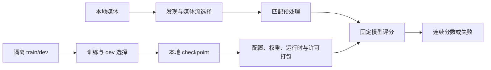

# v0.1.1 双分支离线基线

本版提供带权重、CPython 和 Python 依赖的音频/视频检测系统。输入本地无标签媒体目录，
输出连续伪造分数、覆盖率与逐样本失败，支持中断恢复。运行时不安装依赖或下载模型。
音频仅为环境音 AST 研究候选，尚未提供覆盖语音、音乐和混合内容的通用音频模型；
视频为 ResNet18 部分微调候选，跨生成器表现仍有限。两项权重的赛用许可均未确认，
官方输入输出接口尚待适配，不应将本包称为最终参赛模型。

## 下载与启动

从项目 Releases 下载 v0.1.1 的全部 `deepfake-v0.1.1-linux-x86_64.tar.gz.part-*` 和 `SHA256SUMS`，
放在同一目录。校验一次、合并解压：

```bash
sha256sum -c SHA256SUMS
cat deepfake-v0.1.1-linux-x86_64.tar.gz.part-* | tar -xz
cd deepfake-v0.1.1
./run.sh --help
./run.sh predict --config configs/audio-environment.json --input media/audio --output runs/demo-audio
./run.sh predict --config configs/video.json --input media/video --output runs/demo-video
```

目标是 Linux x86_64、glibc 2.35 或兼容环境。包内提供 CPython 3.12 与 CUDA 13.2
构建的 PyTorch；GPU 推理需要兼容驱动，本版实测 RTX4090 / 595.91.07。
系统 PATH 需有 FFmpeg 和 ffprobe（支持 `-fps_mode`），两者不随包分发。
当前团队服务器已全局安装。CPU 可用 `--device cpu`，无需另装 Python 或 pip。
首次解压约需7GB，另为输入与评分输出留空间；不支持 Windows/macOS。

## 对实际媒体评分

音频、视频按两个赛项分别调用，不读取视频音轨作为音频结果：

```bash
./run.sh predict --config configs/audio-environment.json --input /data/audio --output /results/audio
./run.sh predict --config configs/video.json --input /data/video --output /results/video
# 中断后，使用同一输入、模型和输出目录
./run.sh predict --config configs/video.json --input /data/video --output /results/video --resume
```

支持 WAV/FLAC/MP3/M4A/OGG/AAC/OPUS 与 MP4/MKV/AVI/WEBM/MOV/MPEG/M4V。
递归读取对应格式文件，`sample_id` 是输入根目录内的相对路径，保留扩展名、中文和子目录。
音频通过 FFmpeg 转为16kHz单声道；环境音模型居中裁剪至4秒，短音频两侧补零，
非静音波形按峰值缩放至0.95。训练特征与推理共用该策略，静音保持零。
这是解码后波形处理的一致性；不同重采样器和有损编解码仍可能产生数值差异。
视频采样4帧，按 checkpoint 的预处理与聚合评分；这些是固定基线参数，不代表完整时序建模。

每次使用新输出目录；中断续跑加 `--resume`。输入或模型发生变化时开新目录。
输出目录和输入目录分开放置。无标签输入不计算 EER。

| 文件 | 用途 |
| --- | --- |
| `scores.csv` | 成功样本按输入顺序导出，列为 `sample_id,score`；高分更伪造，通常为 logit |
| `scores.csv.metadata.json` | 导出数、失败 ID、覆盖率和分数方向；须与 CSV 一起读取 |
| `scores.jsonl` | 每个输入的分数或明确失败；不编造兜底分数 |
| `report.json` | 样本数、覆盖率、失败原因、耗时与吞吐 |
| `manifest.jsonl` / `inference.json` | 输入清单与本次实际解析配置 |
| `metadata.json` | 固定输入和模型的恢复身份 |

有媒体失败时仍输出成功子集 CSV，返回退出码2；全失败时 CSV 仅含表头。
CSV 不填充失败分数，因此不能将部分覆盖结果冒充完整提交。显式 `export` 和官方 adapter
保持严格导出，失败或覆盖不完整时拒绝。内存不足、缺失依赖等全局故障立即中止，
已完成的逐样本记录保留，可在解决环境问题后用原输入/config 续跑；未完成批次不生成新 CSV。
恢复时若输入或配置有冲突，拒绝继续并保留原运行产物；已有 CSV 仍属于原运行，不能当作新输入结果。
这是项目本地输出约定，不能把 CSV 直接标成已确认的官方提交。
正式列名、分数方向和输入 ID 规则在平台样例明确后集中修改 adapter。

## 开发与重建

当前另有未公开发布的 `0.1.2-rc1` 研究包，使用原 v0.1.1 权重和下述统一入口，
位于团队服务器 `/var/tmp/deepfake-offline54-20261014/relocated/deepfake-v0.1.2-rc1/`。
已完成真实搬移、CPU/GPU演示、440条profile及实际中断恢复；真实唯一语音10,000条全成功，
端到端1,800.67秒；视频10,000条全成功，端到端2,317.95秒，详见
[视频容量](experiments/video-capacity-20261016/README.md)。这些结果绑定原研究包，
不能覆盖更换工具、候选或操作系统后的容量；独立新环境由后续包验收。
系统依赖、资源结果与未完成项见[实验记录](experiments/offline-entry-20261014/README.md)。
已下载的 v0.1.1 压缩包仍按本页原命令使用。

### 统一预测入口（当前源码）

单文件、多文件、混合目录使用同一个入口，按 FFprobe 检测的实际媒体流路由。
有非封面视频流时仅做视频检测，否则取音频流；音频封面图不作为视频，
仅含音频的 MP4 作为音频处理。多个候选流按索引取第一个，不融合视频音轨。

源码开发时显式指定已取得的本地模型包；团队服务器示例：

```bash
export DEEPFAKE_MODEL_PACKAGE=/var/tmp/deepfake-offline54-20261014/relocated/deepfake-v0.1.2-rc1
scripts/devctl run python -m deepfake_detection_archive predict --show-models
scripts/devctl run python -m deepfake_detection_archive predict \
  /data/clip.mp4 /data/录音.wav /data/mixed --output outputs/mixed
# 相同输入、模型和输出目录恢复
scripts/devctl run python -m deepfake_detection_archive predict \
  /data/clip.mp4 /data/录音.wav /data/mixed --output outputs/mixed --resume
```

新构建的离线包将默认从包内 `configs/models.json` 加载固定模型，使用
`./run.sh predict INPUT... --output DIR`，无需上述环境变量。此变更尚未进入已发布的
v0.1.1 压缩包。原 `predict --config ... --input ...` 和 `infer --config ...` 保持可用。
`--show-models` 显示模型标识、研究范围、分数方向和预处理版本，不读取输入媒体。
统一入口提高输入便利性，音频仍是环境音研究候选，视频仍是四帧基线。

训练与发布决定固定资产；预测消费本地包内资产：



| 输出 | 用途 |
| --- | --- |
| `discovery.json` | 每条发现项及路径别名；媒体、重复、排除和错误均记账 |
| `results.jsonl` | 每个登记媒体的模态、流索引、模型、连续分数或明确失败/未执行 |
| `scores.csv` | 成功子集，包含 `sample_id,path,modality,model_id,score` |
| `report.json` | 发现计数、各模态覆盖率和全局错误 |
| `audio/`、`video/` | 复用原评分器的逐样本分数与恢复产物 |

同一规范路径重复传入会合并并记录别名；不同路径下的相同字节仍是独立输入。
输入 ID 根据规范绝对路径生成，移动输入后应新建输出目录。输出目录中的产物被排除，
符号链接项记入发现账本。缺失或损坏媒体不会补造分数；失败和未执行均使退出码为2。
恢复绑定实际输入、配置、权重和推理实现；文档或无关 CLI 修改不使已完成分数失效。

源码 checkout 使用共享环境运行同一入口：

```bash
scripts/devctl run python -m deepfake_detection_archive predict \
  --config /path/to/deepfake-v0.1.1/configs/audio-environment.json \
  --input /data/audio --output outputs/audio
```

维护者在对应tag的源码checkout中，用已取得的本地权重与环境构建，
不自动下载或读取训练/holdout媒体：

```bash
scripts/devctl run python tools/build_release.py \
  --version 0.1.1 \
  --output outputs/releases/deepfake-v0.1.1 \
  --site-packages /opt/venvs/deepfake-cu132/lib/python3.12/site-packages \
  --python-home /opt/uv/python/cpython-3.12.15-linux-x86_64-gnu \
  --audio-weight /path/to/v0.1.1/weights/audio-ast-urban.pt \
  --video-weight /path/to/v0.1.1/weights/video-resnet18.pt
tar -C outputs/releases -czf outputs/releases/deepfake-v0.1.1-linux-x86_64.tar.gz deepfake-v0.1.1
split -b 1900M -d outputs/releases/deepfake-v0.1.1-linux-x86_64.tar.gz \
  outputs/releases/deepfake-v0.1.1-linux-x86_64.tar.gz.part-
```

包内 `release.json` 标识版本、构建源码、平台、权重及实际运行依赖版本，
`deps/uv.lock` 记录完整构建环境。发布包按已安装 wheel 的 `Requires-Dist` 闭包和
`RECORD` 复制运行文件，移除开发工具，保留 Torch 声明的 Triton/CUDA 依赖。
新构建的 `release.json` 从音频 checkpoint 记录 `ast_frontend`。NumPy 权重不因构建环境
装有 torchaudio 而切换前端，也不额外打包该依赖；明确使用 Kaldi 的权重才打包 torchaudio。
已发布 v0.1.1 与本轮 RC 包保持原内容，当前源码可在已安装 torchaudio 的环境恢复其 NumPy 权重。
包内含可直接运行的无标签演示清单。目录搬移后不依赖原仓库、训练路径或共享虚拟环境。
来源、版权与非商业限制见包内 `licenses/README.md`，项目内见 `docs/release-licenses.md`。

### 包内媒体工具与容器构建

构建器可通过 `--media-tools /path/to/media-tools` 收集固定 FFmpeg/ffprobe。
`run.py` 和 Python API 共用工具选择：`DEEPFAKE_MEDIA_TOOLS` 显式指定的 bin
目录优先，其次包内 `runtime/media-tools/bin`，源码开发未配置工具时使用 PATH。
显式目录或已存在的包内工具不完整时直接报错，不回退到另一构建。
工具变更记录在统一入口恢复身份中，不能混入旧运行继续写分数。

当前工具配方固定原服务器对应的 [FFmpeg ba987fe24d](https://github.com/FFmpeg/FFmpeg/tree/ba987fe24d6713c4d4b3a15cebaeca18c41fbd31)，
保留原生解码器、滤镜和 swscale/swresample，禁用第三方自动探测、GPL、nonfree、网络和硬件解码。
FFmpeg 自身库静态链接，系统 glibc/libm 仍需目标机提供。**该构建不支持 AV1 软件解码**，
不作为现有服务器完整 GPL 工具的无条件替换。源码原包、许可、配方和二进制哈希随工具保存。构建需要 GCC、make 和 nasm。
样例生成仍使用构建机的 FFmpeg/libx264；目标机预测不需要编码器。

```bash
curl -fL https://github.com/FFmpeg/FFmpeg/archive/ba987fe24d6713c4d4b3a15cebaeca18c41fbd31.tar.gz -o ffmpeg-ba987fe24d.tar.gz
bash tools/build_media_tools.sh ffmpeg-ba987fe24d.tar.gz /path/to/new-media-tools
# tools/build_release.py 的原构建参数另加 --media-tools /path/to/new-media-tools
```

`containers/Dockerfile.offline` 固定已核对的 Ubuntu 24.04 amd64 manifest digest，
只复制构建好的 `package/`，不在推理时安装或下载。构建目录仅放该包和 Dockerfile，
预先加载基座；CPU/cu126 以包内实际依赖为准，不能仅改镜像标签。

```bash
docker build --network=none -f Dockerfile.offline -t deepfake:research .
docker run --rm --network=none --read-only --tmpfs /tmp \
  --user "$(id -u):$(id -g)" -v /data/media:/inputs:ro \
  -v /data/results:/outputs -v /data/cache:/cache \
  deepfake:research predict /inputs --device cpu --output /outputs/run
# NVIDIA 模式另加 docker 参数 --gpus，应用参数使用 --device cuda。
docker image save -o deepfake-research-image.tar deepfake:research
sha256sum deepfake-research-image.tar
docker image load -i deepfake-research-image.tar
```

输出与缓存挂载目录须允许所选 UID/GID 写入；不需要 privileged、Docker socket 或 chmod777。
GPU 仍依赖宿主驱动和 NVIDIA Container Toolkit。当前服务器没有 Docker/Podman，
**镜像 build/run/save/load 尚未实测**；Dockerfile 不算已交付镜像，也不替代非 Docker 包。

## v0.1.1 变更与算法范围

修复部分失败时整批没有 CSV、环境级故障被吞成逐样本失败、环境音训练与推理的
裁剪/补齐/幅值策略不一致。音频配置改名为 `audio-environment.json`，旧权重缺少新策略
字段时仍按原策略运行；本版两项权重仅迁移配置，模型参数全部保持不变。
视频采用4帧均值聚合，`trim_fraction=0`，没有声称剔除异常帧。

AST 的上游 Transformers NumPy 前端使用128个 mel 滤波器、257个频点，默认配置也会
报告一列全零滤波器。本版保持预训练前端，未压制告警或改 FFT 消警；这不证明它与
TorchAudio 前端完全等价。参考[固定上游实现](https://github.com/huggingface/transformers/blob/c4c4605f961877852b89b97478536bb3a26b6fd1/src/transformers/models/audio_spectrogram_transformer/feature_extraction_audio_spectrogram_transformer.py)。

v0.1.0 视频权重已有全量1,949条、19生成器诊断，EER31.33%，并非只有310条子集评测，
见[原实验](https://github.com/lanjianyu060915-web/deepfake-detection-archive/blob/v0.1.1/docs/experiments/offline-dual-branch-20261012/README.md#53-新生成器泛化vif-bench-诊断配对)。
原始跨生成器数据含尺寸和时长捷径，不能据此证明内容泛化；受控诊断与局限见
[发布候选复核](https://github.com/lanjianyu060915-web/deepfake-detection-archive/blob/v0.1.1/docs/experiments/release-candidates-20261012/README.md)。
